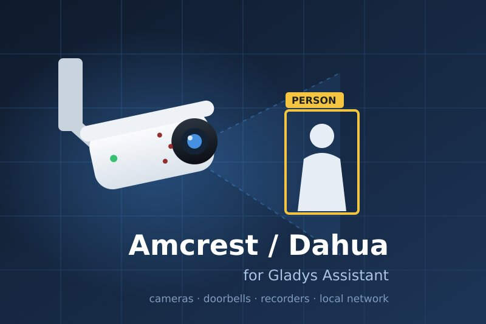
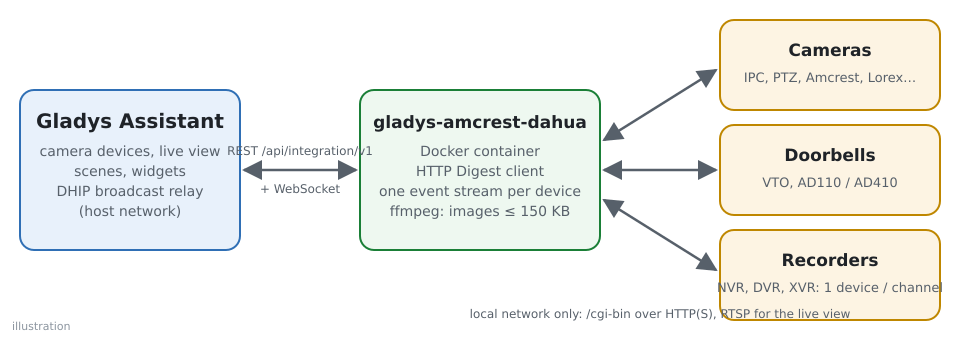
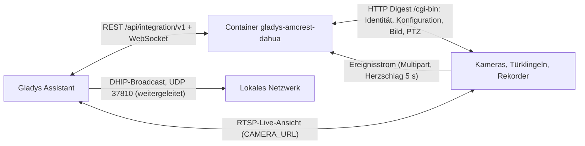
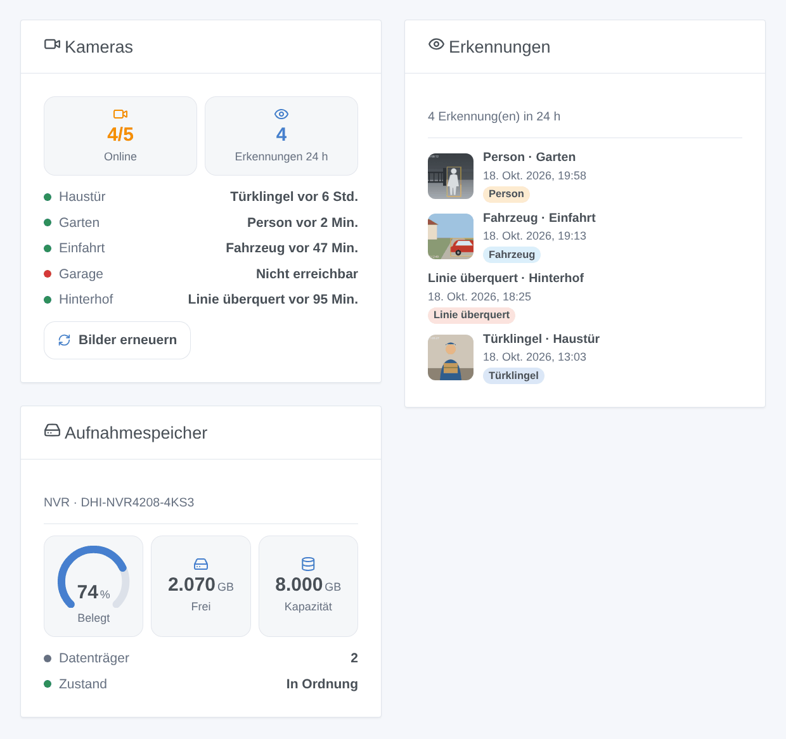

# Gladys Amcrest / Dahua

[English](README.md) · [Français](README.fr.md) · **Deutsch** · [Español](README.es.md)

[](LICENSE)
[](https://github.com/William-De71/gladys-amcrest-dahua/releases)
[](https://github.com/William-De71/gladys-amcrest-dahua/actions/workflows/release.yml)
[](https://gladysassistant.com)



Externe [Gladys Assistant](https://gladysassistant.com)-Integration für Kameras, Türklingeln und Rekorder mit **Dahua-Firmware** (Dahua, Amcrest, Lorex, Imou, EmpireTech und umbenannte Modelle). Bilder, Live-Ansicht, sofortige Bewegungs-, Personen- und Fahrzeugerkennung, IVS-Regeln, Türklingel, Privatmodus und PTZ, alles im lokalen Netzwerk, mit Szenen und Dashboard-Widgets.

Benutzerdokumentation: [English](docs/en.md) · [Français](docs/fr.md) · [Deutsch](docs/de.md) · [Español](docs/es.md).

> Community-Integration, weder mit Dahua Technology noch mit Amcrest verbunden oder von ihnen unterstützt.

## Funktionen

- **Erkennung ohne Adresseingabe**: die DHIP-Suche des Dahua ConfigTool, von Gladys gesendet; Adressen lassen sich für ein anderes VLAN weiterhin eingeben.
- **Ein Gerät pro Kamera** (eines pro Kanal eines NVR, DVR oder XVR): Bild, RTSP-Live-Ansicht (Haupt- oder Substream), Bewegung, Person und Fahrzeug (intelligente Bewegungserkennung), Linienüberquerung und Eindringen (IVS), Türklingel, Schalter der Bewegungserkennung, Privatmodus, PTZ-Bewegungen und -Positionen — jeweils nur, wenn das Gerät es hat.
- **Sofortige Ereignisse**: ein dauerhafter Ereignisstrom pro Gerät (`eventManager attach`, Herzschlag alle 5 s), mit wachsender Wartezeit neu verbunden.
- **4 Szenenauslöser**: Erkennung (8 Arten), Alarm (Videoverlust, Alarmeingang, Speicher), Kamera nicht erreichbar, Kamera wieder da.
- **4 Szenenaktionen**: Bild aufnehmen, Aufnahmemodus, Tür öffnen (VTO), neu starten.
- **3 Dashboard-Widgets**: Kameras, Erkennungen (jeweils mit Bild), Aufnahmespeicher.
- **Schonend für die Kameras**: HTTP Digest, zwei Anfragen gleichzeitig pro Gerät, Bilder mit ffmpeg unter die 150 KB von Gladys verkleinert, und ein abgelehntes Passwort zehn Minuten pausiert (eine Kamera sperrt das Konto nach fünf Fehlversuchen für 30 Minuten).
- Überall vier Sprachen: Englisch, Französisch, Deutsch, Spanisch.

## Funktionsweise





```mermaid
sequenceDiagram
  participant U as Benutzer
  participant G as Gladys
  participant I as Integration
  participant D as Kamera
  U->>G: Entdecken → Suchen
  G->>I: Suchanfrage
  I->>G: scanNetwork(udp-active-broadcast, DHIP-Anfrage)
  G-->>I: DHIP-Antworten (Seriennummer, Modell, HTTP-Port)
  I->>D: getSystemInfo, getConfig (MotionDetect, SmartMotionDetect, VideoAnalyseRule…), PTZ-Fähigkeiten
  I->>G: gefundene Geräte
  U->>G: fügt die Kamera hinzu
  G->>I: Gerät angelegt
  I->>D: eventManager attach (bleibt offen)
  I->>G: Zustände + erstes Bild
  D-->>I: Code=SmartMotionHuman;action=Start
  I->>G: Person = 1 + Szenenereignis „Erkennung“ + Bild
  G->>I: Wert „Bewegen: links“
  I->>D: ptz start Left, 600 ms, ptz stop Left
```

### Transport

`transports: ["local"]`: Alles bleibt in Ihrem Netzwerk, ohne Konto und ohne Cloud des Herstellers. Die einzige Berechtigung ist der weitergeleitete UDP-Broadcast auf Port 37810 (DHIP-Erkennung).

## Geräte und Funktionen

| Funktion           | Wann                                       | Kategorie / Typ              |
| ------------------ | ------------------------------------------ | ---------------------------- |
| Bild               | immer                                      | `camera` / `image`           |
| Bewegung           | immer                                      | `motion-sensor` / `binary`   |
| Person, Fahrzeug   | intelligente Bewegungserkennung (SMD)      | `motion-sensor` / `binary`   |
| Linienüberquerung  | eine IVS-Regel „Linienüberquerung“         | `motion-sensor` / `binary`   |
| Eindringen         | eine IVS-Regel „Eindringen“                | `motion-sensor` / `binary`   |
| Türklingel         | VTO, Amcrest AD110 / AD410, Imou DB61i…    | `doorbell` / `ring` (Impuls) |
| Bewegungserkennung | `MotionDetect` lesbar                      | `switch` / `binary`          |
| Kamera aktiviert   | `LeLensMask` (Privatmodus Amcrest, Imou)   | `camera` / `enabled`         |
| Bewegen            | PTZ (Schwenken, Neigen, Zoom je nach Kopf) | `camera` / `move`            |
| Position           | PTZ mit gespeicherten Positionen           | `camera` / `preset`          |

Die Geräte werden jede Minute abgefragt (`should_poll`, 60 s), um die Schalter zurückzulesen; das Bild wird per Zeitgeber (standardmäßig 60 s) und bei jeder Erkennung veröffentlicht. Die Live-Ansicht der Kamera-Box nutzt den Parameter `CAMERA_URL` (RTSP).

## Szenenauslöser, -aktionen und Widgets



- Auslöser: **Erkennung** (Filter Kamera und Art; Variablen Name der Kamera, Art, Name der IVS-Regel, Objekttyp), **Alarm** (Video verloren, Alarmeingang, Speicherfehler, fast voll, fehlend), **Kamera nicht erreichbar**, **Kamera wieder da**.
- Aktionen: **Bild aufnehmen** (Ausgaben: Zeit, Größe), **Aufnahmemodus** (Zeitplan, immer, aus), **Tür öffnen** (VTO), **neu starten**.
- Widgets: **Kameras**, **Erkennungen**, **Aufnahmespeicher**.
- Beispiele: beim Klingeln das Bild der Haustür senden; nachts eine Person im Garten und niemand zu Hause → Licht an und Benachrichtigung; alle sind weg → immer aufnehmen.

Nicht umgesetzt: Sirene und Weißlicht der Kameras mit aktiver Abschreckung (mehrere inkompatible APIs, ohne Hardware nicht testbar), Infrarotmodus, Gegensprechen, Wiedergabe von Aufnahmen, Kennzeichen- und Gesichtserkennungsereignisse, der DHIP-Ereigniskanal der VTO-Türklingeln (Port 5000).

## Voraussetzungen

- Gladys **5.3.0** oder neuer (ältere Versionen können die Integration nicht installieren: Suchbegriffe und Länder des Katalogs, Widgets und Szenen).
- Ein Gerät mit Dahua-Firmware mit aktiviertem HTTP, aktiviertem RTSP für die Live-Ansicht, und sein Konto.

## Installation

- **Aus dem Store**: Integrationen → Amcrest / Dahua → Installieren.
- **Über die Repository-URL**: Integrationen → Externe Integration hinzufügen → `https://github.com/William-De71/gladys-amcrest-dahua`.
- **Entwicklermodus**: `npm install`, dann neben einem Gladys im Entwicklermodus mit den Variablen unten starten.

## Konfiguration

| Feld                     | Standard | Zweck                                                                             |
| ------------------------ | -------- | --------------------------------------------------------------------------------- |
| Benutzername             | `admin`  | Konto der Weboberfläche                                                           |
| Passwort                 | —        | Sein Passwort (`secret`)                                                          |
| Bildaktualisierung       | 60       | Dashboard-Bild alle N Sekunden, 10 bis 3600, 0 = aus                              |
| Bild bei jeder Erkennung | ja       | Ein Bild, wenn eine Bewegung, eine Person, ein Fahrzeug oder ein Klingeln beginnt |
| Stream der Live-Ansicht  | Haupt    | `main` oder `sub`                                                                 |
| Geräteadressen           | —        | `192.168.1.108, 192.168.1.20:8080, https://192.168.1.30`                          |
| Konten pro Gerät         | —        | `adresse\|benutzer\|passwort`, durch Kommas getrennt (`secret`)                   |

Konfigurationsaktionen: **Verbindung testen** (Modell, Kameras und Fähigkeiten jedes Geräts, oder warum es nicht erreichbar ist), **Bilder aktualisieren**.

## Verwendung

Speichern Sie das Konto, öffnen Sie **Entdecken**, starten Sie eine Suche und fügen Sie die Kameras hinzu. Fügen Sie einem Dashboard eine Kamera-Box und die Widgets hinzu und bauen Sie dann Szenen auf den Auslösern auf.

## Entwicklung

```bash
npm install
npm test                     # node --test, berührt nie das Netzwerk (Fake-Kamera im Speicher)
npm run lint && npm run format:check
npx github:GladysAssistant/integration-store . --skip-image-check
node scripts/lab-camera.mjs  # die Fake-Kamera über echtes HTTP (Digest, Ereignisse), für einen manuellen Test
docs/illustrations/render.sh # Illustrationen der Widgets
scripts/build-cover.sh       # cover.jpg
```

Umgebungsvariablen (vom Gladys-Supervisor gesetzt): `GLADYS_HOST_API_URL`, `GLADYS_INTEGRATION_TOKEN`, `GLADYS_INTEGRATION_SELECTOR`. Die Integration schreibt nichts nach `/data`. Die Aufrufe an die Kameras laufen nur über `src/dahua/transport.js`, in den Tests durch `test/helpers/fake-camera.js` ersetzt.

## Release-Prozess


Jeder Merge auf `main` startet die CI und berechnet dann die Version aus den [Conventional Commits](https://www.conventionalcommits.org/) seit dem letzten Tag: `feat` → Minor, `fix` / `perf` → Patch, `!` oder `BREAKING CHANGE` → Major (unter 1.0.0 ein Minor); `docs`, `chore`, `ci`, `test`, `style`, `refactor`, `build` allein veröffentlichen nichts. Ohne Tag wird 0.1.0 unverändert veröffentlicht. Der Changelog-Abschnitt wird erzeugt, der Tag gepusht, das Multi-Architektur-Image gebaut, dann erhält `main` den Release-Commit (der Store sieht also nie eine Version ohne ihr Image), das GitHub-Release wird erstellt und ein letzter Job prüft das öffentliche Image, den Store-Validator und das Topic.

- Der Titel des Pull-Requests wird zum Squash-Commit und dann zur Changelog-Zeile: Schreiben Sie ihn auf Englisch, für den Benutzer (`pr-title.yml` prüft ihn). Bearbeiten Sie `CHANGELOG.md` nie von Hand.
- 1.0.0 ist eine Entscheidung: Actions → Release → Run workflow mit `release-as: 1.0.0`. `dry-run` zeigt Version und Notizen, ohne zu veröffentlichen.
- **Geschützter Branch**: Das Release pusht seinen Commit mit `GITHUB_TOKEN` auf `main`. Verlangt ein Ruleset auf `main` Pull-Requests oder Status-Checks, fügen Sie GitHub Actions seiner Bypass-Liste hinzu (oder pushen Sie über eine GitHub App), sonst scheitert der Veröffentlichungsjob. Das Ruleset `protect-main` (kein Löschen, kein Force-Push) lässt ihn durch.
- Nach dem ersten Release muss das Paket auf `ghcr.io` öffentlich sein (Package settings → Change visibility).

## Fehlerbehebung

Siehe [docs/de.md](docs/de.md#fehlerbehebung) (abgelehntes Passwort und Sperre, Gerät bei der Suche nicht gefunden, HTTP-Port, RTSP, fehlender Personensensor, VTO-Klingeln). Melden Sie Probleme mit den Versionen von Gladys und der Integration, Modell und Firmware des Geräts und dem Ergebnis von **Verbindung testen**.

## Mitwirken

Issues und Pull-Requests sind willkommen, besonders Rückmeldungen von Besitzern noch nicht getesteter Modelle. Führen Sie vor einem Pull-Request `npm run format:check && npm run lint && npm test` aus und lassen Sie alle externen IDs und gespeicherten Schlüssel unverändert (siehe [CLAUDE.md](CLAUDE.md)).

## Sicherheit

Siehe [SECURITY.md](SECURITY.md): Melden Sie Schwachstellen vertraulich. Die Passwörter sind `secret`-Felder und werden nie protokolliert. Die RTSP-Adresse, die Gladys für die Live-Ansicht erhält (Geräteparameter `CAMERA_URL`), enthält das Kamerakonto, wie es der Kameradienst von Gladys verlangt: Geben Sie der Integration einen eigenen Benutzer mit den nötigen Rechten statt `admin`, wenn andere Personen Ihr Gladys verwalten. HTTPS-Kameras nutzen selbstsignierte Zertifikate, die im lokalen Netzwerk ohne Prüfung akzeptiert werden.

## Lizenz

[Apache-Lizenz 2.0](LICENSE) — siehe auch [NOTICE](NOTICE).
