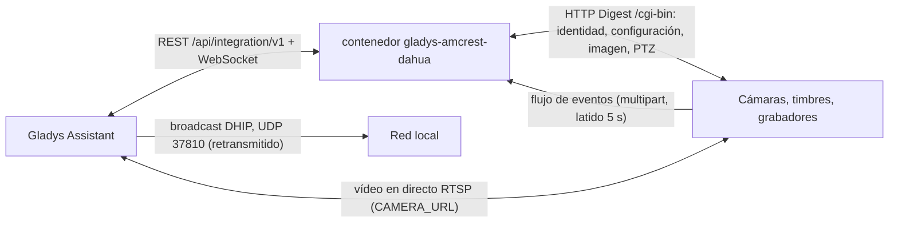
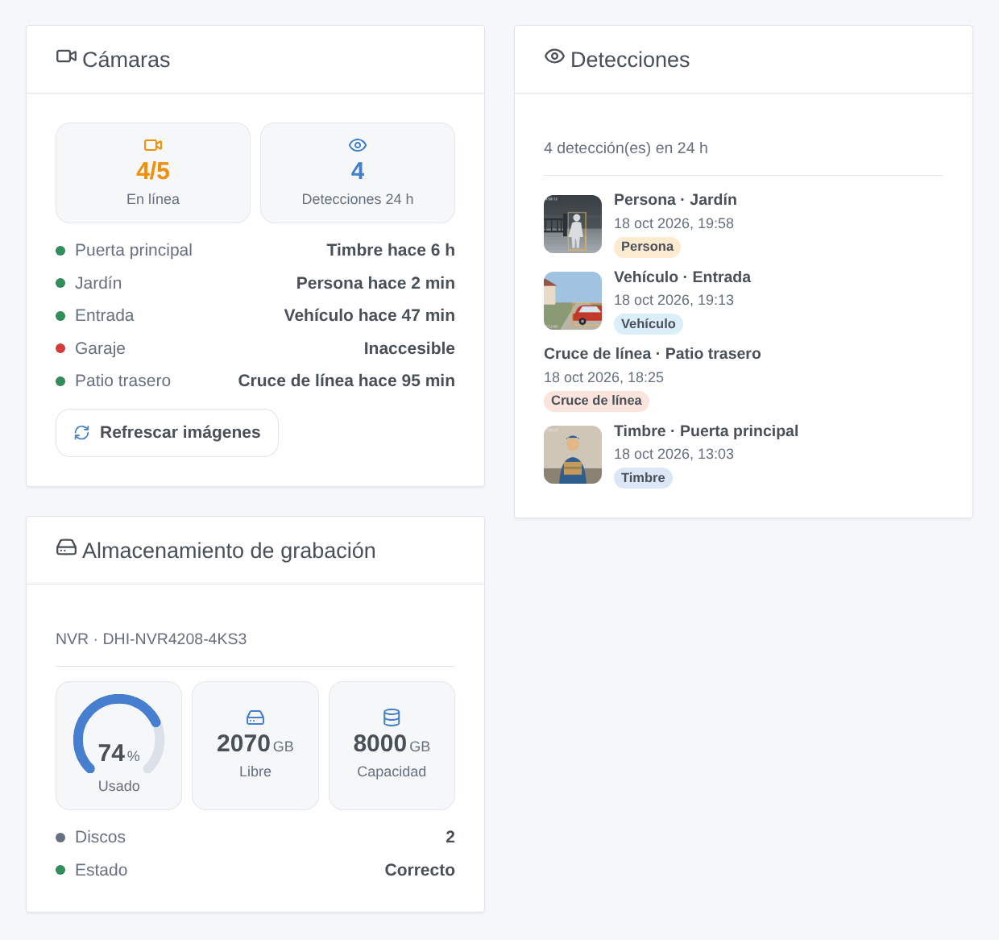

# Gladys Amcrest / Dahua

[English](README.md) · [Français](README.fr.md) · [Deutsch](README.de.md) · **Español**

[](LICENSE)
[](https://github.com/William-De71/gladys-amcrest-dahua/releases)
[](https://github.com/William-De71/gladys-amcrest-dahua/actions/workflows/release.yml)
[](https://gladysassistant.com)


Integración externa de [Gladys Assistant](https://gladysassistant.com) para las cámaras, timbres y grabadores con **firmware Dahua** (Dahua, Amcrest, Lorex, Imou, EmpireTech y modelos con otra marca). Imágenes, vídeo en directo, detecciones instantáneas de movimiento, personas y vehículos, reglas IVS, timbre, modo privado y PTZ, todo en la red local, con escenas y widgets del panel.

Documentación de usuario: [English](docs/en.md) · [Français](docs/fr.md) · [Deutsch](docs/de.md) · [Español](docs/es.md).

> Integración comunitaria, sin relación con Dahua Technology ni Amcrest y sin su respaldo.

## Funciones

- **Descubrimiento sin escribir direcciones**: la búsqueda DHIP de la herramienta ConfigTool de Dahua, difundida por Gladys; las direcciones se pueden seguir introduciendo para otra VLAN.
- **Un dispositivo por cámara** (uno por canal de un NVR, DVR o XVR): imagen, vídeo en directo RTSP (flujo principal o secundario), movimiento, persona y vehículo (detección de movimiento inteligente), cruce de línea e intrusión (IVS), timbre, interruptor de la detección de movimiento, modo privado, movimientos y posiciones PTZ — cada uno solo si el dispositivo lo tiene.
- **Eventos instantáneos**: un flujo de eventos de larga duración por dispositivo (`eventManager attach`, latido cada 5 s), reconectado con una espera creciente.
- **4 activadores de escena**: detección (8 tipos), alarma (pérdida de vídeo, entrada de alarma, almacenamiento), cámara inaccesible, cámara recuperada.
- **4 acciones de escena**: tomar una imagen, modo de grabación, abrir la puerta (VTO), reiniciar.
- **3 widgets del panel**: Cámaras, Detecciones (con la imagen de cada una), Almacenamiento de grabación.
- **Cuidadosa con las cámaras**: HTTP Digest, dos peticiones a la vez por dispositivo, imágenes reducidas por debajo de los 150 KB de Gladys con ffmpeg, y una contraseña rechazada en pausa diez minutos (una cámara bloquea la cuenta 30 minutos tras cinco fallos).
- Cuatro idiomas en todas partes: inglés, francés, alemán, español.

## Funcionamiento




```mermaid
sequenceDiagram
  participant U as Usuario
  participant G as Gladys
  participant I as Integración
  participant D as Cámara
  U->>G: Descubrir → Buscar
  G->>I: petición de búsqueda
  I->>G: scanNetwork(udp-active-broadcast, sonda DHIP)
  G-->>I: respuestas DHIP (número de serie, modelo, puerto HTTP)
  I->>D: getSystemInfo, getConfig (MotionDetect, SmartMotionDetect, VideoAnalyseRule…), capacidades PTZ
  I->>G: dispositivos descubiertos
  U->>G: añade la cámara
  G->>I: dispositivo creado
  I->>D: eventManager attach (abierto)
  I->>G: estados + primera imagen
  D-->>I: Code=SmartMotionHuman;action=Start
  I->>G: Persona = 1 + evento de escena «detección» + imagen
  G->>I: valor «Mover: izquierda»
  I->>D: ptz start Left, 600 ms, ptz stop Left
```

### Transporte

`transports: ["local"]`: todo se queda en su red, sin cuenta ni nube de la marca. El único permiso es el broadcast UDP retransmitido en el puerto 37810 (descubrimiento DHIP).

## Dispositivos y funciones

| Función                 | Cuándo                                         | Categoría / tipo            |
| ----------------------- | ---------------------------------------------- | --------------------------- |
| Imagen                  | siempre                                        | `camera` / `image`          |
| Movimiento              | siempre                                        | `motion-sensor` / `binary`  |
| Persona, Vehículo       | detección de movimiento inteligente (SMD)      | `motion-sensor` / `binary`  |
| Cruce de línea          | una regla IVS «cruce de línea»                 | `motion-sensor` / `binary`  |
| Intrusión               | una regla IVS «intrusión»                      | `motion-sensor` / `binary`  |
| Timbre                  | VTO, Amcrest AD110 / AD410, Imou DB61i…        | `doorbell` / `ring` (pulso) |
| Detección de movimiento | `MotionDetect` legible                         | `switch` / `binary`         |
| Cámara activada         | `LeLensMask` (modo privado Amcrest, Imou)      | `camera` / `enabled`        |
| Mover                   | PTZ (giro, inclinación, zoom según el cabezal) | `camera` / `move`           |
| Posición                | PTZ con posiciones guardadas                   | `camera` / `preset`         |

Los dispositivos se consultan cada minuto (`should_poll`, 60 s) para releer los interruptores; la imagen se publica con un temporizador (60 s por defecto) y en cada detección. El vídeo en directo del bloque Cámara usa el parámetro `CAMERA_URL` (RTSP).

## Activadores, acciones de escena y widgets



- Activadores: **detección** (filtros cámara y tipo; variables nombre de la cámara, tipo, nombre de la regla IVS, tipo de objeto), **alarma** (vídeo perdido, entrada de alarma, fallo de almacenamiento, casi lleno, ausente), **cámara inaccesible**, **cámara recuperada**.
- Acciones: **tomar una imagen** (salidas: hora, tamaño), **modo de grabación** (horario, siempre, apagado), **abrir la puerta** (VTO), **reiniciar**.
- Widgets: **Cámaras**, **Detecciones**, **Almacenamiento de grabación**.
- Ejemplos: cuando llaman al timbre, enviar la imagen de la puerta principal; una persona en el jardín de noche sin nadie en casa → luces encendidas y notificación; todos se han ido → grabar siempre.

No implementado: sirena y luz blanca de las cámaras con disuasión activa (varias API incompatibles, imposibles de probar sin el hardware), modo infrarrojo, audio bidireccional, reproducción de grabaciones, eventos de lectura de matrículas y reconocimiento facial, el canal de eventos DHIP de los timbres VTO (puerto 5000).

## Requisitos

- Gladys **5.3.0** o posterior (las versiones anteriores no pueden instalar la integración: palabras clave y países del catálogo, widgets y escenas).
- Un dispositivo con firmware Dahua con HTTP activado, RTSP activado para el vídeo en directo, y su cuenta.

## Instalación

- **Desde la tienda**: Integraciones → Amcrest / Dahua → Instalar.
- **Desde la URL del repositorio**: Integraciones → Añadir una integración externa → `https://github.com/William-De71/gladys-amcrest-dahua`.
- **Modo desarrollador**: `npm install` y después ejecútela junto a un Gladys en modo desarrollador con las variables de abajo.

## Configuración

| Campo                           | Por defecto | Uso                                                                               |
| ------------------------------- | ----------- | --------------------------------------------------------------------------------- |
| Usuario                         | `admin`     | Cuenta de la interfaz web                                                         |
| Contraseña                      | —           | Su contraseña (`secret`)                                                          |
| Actualización de imágenes       | 60          | Imagen del panel cada N segundos, 10 a 3600, 0 = desactivada                      |
| Imagen en cada detección        | sí          | Una imagen cuando empieza un movimiento, una persona, un vehículo o una pulsación |
| Flujo del vídeo en directo      | principal   | `main` o `sub`                                                                    |
| Direcciones de los dispositivos | —           | `192.168.1.108, 192.168.1.20:8080, https://192.168.1.30`                          |
| Cuentas por dispositivo         | —           | `dirección\|usuario\|contraseña`, separadas por comas (`secret`)                  |

Acciones de configuración: **Probar la conexión** (modelo, cámaras y capacidades de cada dispositivo, o por qué no se puede alcanzar), **Actualizar las imágenes**.

## Uso

Guarde la cuenta, abra **Descubrir**, lance una búsqueda y añada las cámaras. Añada un bloque Cámara y los widgets a un panel, y luego construya escenas con los activadores.

## Desarrollo

```bash
npm install
npm test                     # node --test, nunca toca la red (cámara falsa en memoria)
npm run lint && npm run format:check
npx github:GladysAssistant/integration-store . --skip-image-check
node scripts/lab-camera.mjs  # la cámara falsa por HTTP real (Digest, eventos), para una prueba manual
docs/illustrations/render.sh # ilustraciones de los widgets
scripts/build-cover.sh       # cover.jpg
```

Variables de entorno (definidas por el supervisor de Gladys): `GLADYS_HOST_API_URL`, `GLADYS_INTEGRATION_TOKEN`, `GLADYS_INTEGRATION_SELECTOR`. La integración no escribe nada en `/data`. Las llamadas a las cámaras pasan solo por `src/dahua/transport.js`, sustituido en las pruebas por `test/helpers/fake-camera.js`.

## Proceso de publicación


Cada fusión en `main` lanza la CI y después calcula la versión a partir de los [Conventional Commits](https://www.conventionalcommits.org/) desde la última etiqueta: `feat` → menor, `fix` / `perf` → parche, `!` o `BREAKING CHANGE` → mayor (una menor por debajo de 1.0.0); `docs`, `chore`, `ci`, `test`, `style`, `refactor`, `build` solos no publican nada. Sin etiqueta, la 0.1.0 se publica tal cual. Se genera la sección del changelog, se empuja la etiqueta, se construye la imagen multiarquitectura y después `main` recibe el commit de publicación (la tienda nunca ve una versión sin su imagen), se crea la GitHub Release y un último trabajo comprueba la imagen pública, el validador de la tienda y el topic.

- El título de la pull request se convierte en el commit squash y luego en la línea del changelog: escríbalo en inglés, para el usuario (`pr-title.yml` lo comprueba). No edite nunca `CHANGELOG.md` a mano.
- La 1.0.0 es una decisión: Actions → Release → Run workflow con `release-as: 1.0.0`. `dry-run` muestra la versión y las notas sin publicar.
- **Rama protegida**: la publicación empuja su commit a `main` con `GITHUB_TOKEN`. Con un ruleset que exija pull requests o status checks en `main`, añada GitHub Actions a su lista de excepciones (o empuje mediante una GitHub App); si no, el trabajo de publicación falla. El ruleset `protect-main` (sin borrado ni force push) lo deja pasar.
- Tras la primera publicación, el paquete de `ghcr.io` debe ser público (Package settings → Change visibility).

## Solución de problemas

Consulte [docs/es.md](docs/es.md#solución-de-problemas) (contraseña rechazada y bloqueo, dispositivo no encontrado por la búsqueda, puerto HTTP, RTSP, sensor de persona ausente, pulsaciones del timbre VTO). Informe de los problemas con las versiones de Gladys y de la integración, el modelo y el firmware del dispositivo, y el resultado de **Probar la conexión**.

## Contribuir

Las incidencias y pull requests son bienvenidas, sobre todo los informes de propietarios de modelos aún no probados. Ejecute `npm run format:check && npm run lint && npm test` antes de abrir una pull request y no cambie ningún identificador externo ni ninguna clave almacenada (véase [CLAUDE.md](CLAUDE.md)).

## Seguridad

Consulte [SECURITY.md](SECURITY.md): informe de las vulnerabilidades en privado. Las contraseñas son campos `secret` y nunca se registran. La dirección RTSP que recibe Gladys para el vídeo en directo (parámetro de dispositivo `CAMERA_URL`) contiene la cuenta de la cámara, como exige el servicio de cámaras de Gladys: dé a la integración un usuario dedicado con los permisos necesarios en lugar de `admin` si otras personas administran su Gladys. Las cámaras en HTTPS usan certificados autofirmados, aceptados sin verificación en la red local.

## Licencia

[Licencia Apache 2.0](LICENSE) — véase también [NOTICE](NOTICE).
