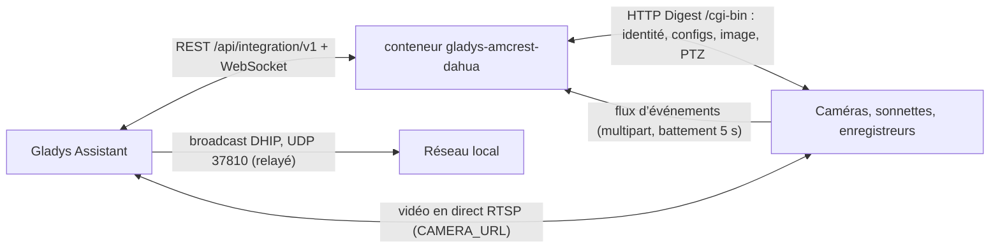
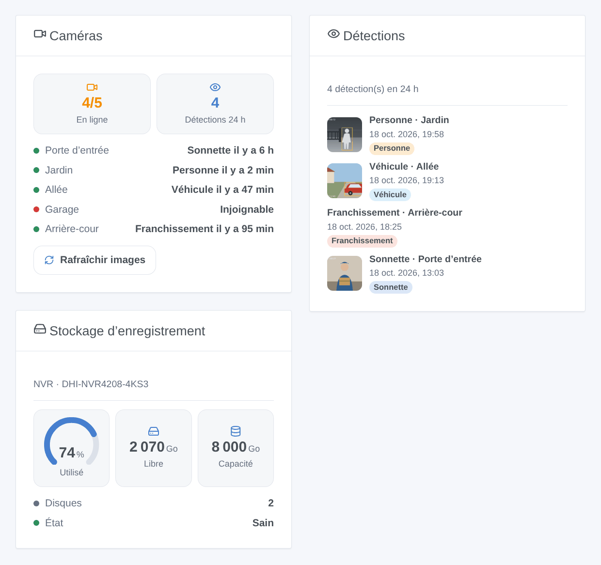

# Gladys Amcrest / Dahua

[English](README.md) · **Français** · [Deutsch](README.de.md) · [Español](README.es.md)

[](LICENSE)
[](https://github.com/William-De71/gladys-amcrest-dahua/releases)
[](https://github.com/William-De71/gladys-amcrest-dahua/actions/workflows/release.yml)
[](https://gladysassistant.com)


Intégration externe [Gladys Assistant](https://gladysassistant.com) pour les caméras, sonnettes et enregistreurs basés sur un **firmware Dahua** (Dahua, Amcrest, Lorex, Imou, EmpireTech et modèles renommés). Images, vidéo en direct, détections instantanées de mouvement, de personnes et de véhicules, règles IVS, sonnette, mode privé et PTZ, le tout sur le réseau local, avec scènes et widgets de tableau de bord.

Documentation utilisateur : [English](docs/en.md) · [Français](docs/fr.md) · [Deutsch](docs/de.md) · [Español](docs/es.md).

> Intégration communautaire, ni affiliée à Dahua Technology ou Amcrest, ni approuvée par eux.

## Fonctionnalités

- **Découverte sans saisir d’adresse** : la recherche DHIP de l’outil ConfigTool de Dahua, diffusée par Gladys ; les adresses restent saisissables pour un autre VLAN.
- **Un appareil par caméra** (un par canal d’un NVR, DVR ou XVR) : image, vidéo en direct RTSP (flux principal ou secondaire), mouvement, personne et véhicule (détection de mouvement intelligente), franchissement et intrusion (IVS), sonnette, interrupteur de détection de mouvement, mode privé, déplacements et positions PTZ — chacun seulement si l’appareil le possède.
- **Événements instantanés** : un flux d’événements longue durée par appareil (`eventManager attach`, battement toutes les 5 s), reconnecté avec un délai croissant.
- **4 déclencheurs de scène** : détection (8 types), alarme (perte vidéo, entrée d’alarme, stockage), caméra injoignable, caméra revenue.
- **4 actions de scène** : prendre une image, mode d’enregistrement, ouvrir la porte (VTO), redémarrer.
- **3 widgets de tableau de bord** : Caméras, Détections (avec l’image de chacune), Stockage d’enregistrement.
- **Respectueuse des caméras** : HTTP Digest, deux requêtes à la fois par appareil, images réduites sous les 150 Ko de Gladys avec ffmpeg, et un mot de passe refusé mis en pause dix minutes (une caméra bloque le compte 30 minutes après cinq échecs).
- Quatre langues partout : anglais, français, allemand, espagnol.

## Fonctionnement




```mermaid
sequenceDiagram
  participant U as Utilisateur
  participant G as Gladys
  participant I as Intégration
  participant D as Caméra
  U->>G: Découverte → Scanner
  G->>I: demande de scan
  I->>G: scanNetwork(udp-active-broadcast, sonde DHIP)
  G-->>I: réponses DHIP (numéro de série, modèle, port HTTP)
  I->>D: getSystemInfo, getConfig (MotionDetect, SmartMotionDetect, VideoAnalyseRule…), capacités PTZ
  I->>G: appareils découverts
  U->>G: ajoute la caméra
  G->>I: appareil créé
  I->>D: eventManager attach (gardé ouvert)
  I->>G: états + première image
  D-->>I: Code=SmartMotionHuman;action=Start
  I->>G: Personne = 1 + événement de scène « détection » + image
  G->>I: valeur « Déplacement : gauche »
  I->>D: ptz start Left, 600 ms, ptz stop Left
```

### Transport

`transports: ["local"]` : tout reste sur votre réseau, sans compte ni cloud de la marque. La seule permission est le broadcast UDP relayé sur le port 37810 (découverte DHIP).

## Appareils et fonctionnalités

| Fonctionnalité         | Quand                                     | Catégorie / type                |
| ---------------------- | ----------------------------------------- | ------------------------------- |
| Image                  | toujours                                  | `camera` / `image`              |
| Mouvement              | toujours                                  | `motion-sensor` / `binary`      |
| Personne, Véhicule     | détection de mouvement intelligente (SMD) | `motion-sensor` / `binary`      |
| Franchissement         | une règle IVS « franchissement de ligne » | `motion-sensor` / `binary`      |
| Intrusion              | une règle IVS « intrusion »               | `motion-sensor` / `binary`      |
| Sonnette               | VTO, Amcrest AD110 / AD410, Imou DB61i…   | `doorbell` / `ring` (impulsion) |
| Détection de mouvement | `MotionDetect` lisible                    | `switch` / `binary`             |
| Caméra activée         | `LeLensMask` (mode privé Amcrest, Imou)   | `camera` / `enabled`            |
| Déplacement            | PTZ (pan, tilt, zoom selon la tourelle)   | `camera` / `move`               |
| Position               | PTZ avec positions enregistrées           | `camera` / `preset`             |

Les appareils sont interrogés chaque minute (`should_poll`, 60 s) pour relire les interrupteurs ; l’image est publiée sur minuterie (60 s par défaut) et à chaque détection. La vidéo en direct de la boîte Caméra utilise le paramètre `CAMERA_URL` (RTSP).

## Déclencheurs, actions de scène et widgets



- Déclencheurs : **détection** (filtres caméra et type ; variables nom de la caméra, type, nom de la règle IVS, type d’objet), **alarme** (vidéo perdue, entrée d’alarme, panne de stockage, presque plein, absent), **caméra injoignable**, **caméra revenue**.
- Actions : **prendre une image** (sorties : heure, taille), **mode d’enregistrement** (planning, toujours, arrêt), **ouvrir la porte** (VTO), **redémarrer**.
- Widgets : **Caméras**, **Détections**, **Stockage d’enregistrement**.
- Exemples : quand on sonne, envoyer l’image de la porte d’entrée ; une personne dans le jardin la nuit sans personne à la maison → lumières allumées et notification ; tout le monde est parti → enregistrer en continu.

Non implémenté : sirène et lumière blanche des caméras à dissuasion active (plusieurs API incompatibles, intestables sans le matériel), mode infrarouge, audio bidirectionnel, relecture des enregistrements, événements de lecture de plaques et de reconnaissance faciale, canal d’événements DHIP des sonnettes VTO (port 5000).

## Prérequis

- Gladys **5.1.0** ou plus récent (les versions plus anciennes ne peuvent pas installer l’intégration : widgets et scènes).
- Un appareil sous firmware Dahua avec HTTP activé, RTSP activé pour la vidéo en direct, et son compte.

## Installation

- **Depuis le store** : Intégrations → Amcrest / Dahua → Installer.
- **Depuis l’URL du dépôt** : Intégrations → Ajouter une intégration externe → `https://github.com/William-De71/gladys-amcrest-dahua`.
- **Mode développeur** : `npm install`, puis lancez-la à côté d’un Gladys en mode développeur avec les variables ci-dessous.

## Configuration

| Champ                       | Par défaut | Rôle                                                                           |
| --------------------------- | ---------- | ------------------------------------------------------------------------------ |
| Identifiant                 | `admin`    | Compte de l’interface web                                                      |
| Mot de passe                | —          | Son mot de passe (`secret`)                                                    |
| Rafraîchissement des images | 60         | Image du tableau de bord toutes les N secondes, 10 à 3600, 0 = arrêt           |
| Image à chaque détection    | oui        | Une image au début d’un mouvement, d’une personne, d’un véhicule ou d’un appui |
| Flux de la vidéo en direct  | principal  | `main` ou `sub`                                                                |
| Adresses des appareils      | —          | `192.168.1.108, 192.168.1.20:8080, https://192.168.1.30`                       |
| Comptes par appareil        | —          | `adresse\|identifiant\|motdepasse`, séparés par des virgules (`secret`)        |

Actions de configuration : **Tester la connexion** (modèle, caméras et capacités de chaque appareil, ou pourquoi il est injoignable), **Rafraîchir les images**.

## Utilisation

Enregistrez le compte, ouvrez **Découverte**, lancez un scan et ajoutez les caméras. Ajoutez une boîte Caméra et les widgets à un tableau de bord, puis construisez vos scènes sur les déclencheurs.

## Développement

```bash
npm install
npm test                     # node --test, ne touche jamais le réseau (fausse caméra en mémoire)
npm run lint && npm run format:check
npx github:GladysAssistant/integration-store . --skip-image-check
node scripts/lab-camera.mjs  # la fausse caméra en vrai HTTP (Digest, événements), pour un essai manuel
docs/illustrations/render.sh # illustrations des widgets
scripts/build-cover.sh       # cover.jpg
```

Variables d’environnement (posées par le superviseur de Gladys) : `GLADYS_HOST_API_URL`, `GLADYS_INTEGRATION_TOKEN`, `GLADYS_INTEGRATION_SELECTOR`. L’intégration n’écrit rien dans `/data`. Les appels aux caméras passent uniquement par `src/dahua/transport.js`, remplacé dans les tests par `test/helpers/fake-camera.js`.

## Processus de release


Chaque fusion sur `main` lance la CI, puis calcule la version à partir des [Conventional Commits](https://www.conventionalcommits.org/) depuis le dernier tag : `feat` → mineure, `fix` / `perf` → correctif, `!` ou `BREAKING CHANGE` → majeure (une mineure sous 1.0.0) ; `docs`, `chore`, `ci`, `test`, `style`, `refactor`, `build` seuls ne publient rien. Sans tag, la 0.1.0 est publiée telle quelle. La section du changelog est générée, le tag poussé, l’image multi-architecture construite, puis `main` reçoit le commit de release (le store ne voit donc jamais une version sans son image), la GitHub Release est créée et un dernier job vérifie l’image publique, le validateur du store et le topic.

- Le titre de la pull request devient le commit squash, puis la ligne du changelog : écrivez-le en anglais, pour l’utilisateur (`pr-title.yml` le vérifie). N’éditez jamais `CHANGELOG.md` à la main.
- La 1.0.0 est une décision : Actions → Release → Run workflow avec `release-as: 1.0.0`. `dry-run` affiche la version et les notes sans rien publier.
- **Branche protégée** : la release pousse son commit sur `main` avec `GITHUB_TOKEN`. Avec un ruleset qui impose des pull requests ou des status checks sur `main`, ajoutez GitHub Actions à sa liste de contournement (ou poussez via une GitHub App), sinon le job de publication échoue. Le ruleset `protect-main` (ni suppression ni force push) le laisse passer.
- Après la première release, le package `ghcr.io` doit être public (Package settings → Change visibility).

## Dépannage

Voir [docs/fr.md](docs/fr.md#dépannage) (mot de passe refusé et blocage, appareil introuvable au scan, port HTTP, RTSP, capteur Personne absent, appuis sur la sonnette VTO). Signalez les problèmes avec les versions de Gladys et de l’intégration, le modèle et le firmware de l’appareil, et le résultat de **Tester la connexion**.

## Contribution

Issues et pull requests bienvenues, en particulier les retours de propriétaires de modèles pas encore testés. Lancez `npm run format:check && npm run lint && npm test` avant d’ouvrir une pull request, et ne changez aucun identifiant externe ni aucune clé stockée (voir [CLAUDE.md](CLAUDE.md)).

## Sécurité

Voir [SECURITY.md](SECURITY.md) : signalez les vulnérabilités en privé. Les mots de passe sont des champs `secret` et ne sont jamais journalisés. L’adresse RTSP donnée à Gladys pour la vidéo en direct (paramètre d’appareil `CAMERA_URL`) contient le compte de la caméra, comme l’exige le service caméra de Gladys : donnez à l’intégration un utilisateur dédié avec les droits nécessaires plutôt qu’`admin` si d’autres personnes administrent votre Gladys. Les caméras en HTTPS utilisent des certificats auto-signés, acceptés sans vérification sur le réseau local.

## Licence

[Licence Apache 2.0](LICENSE) — voir aussi [NOTICE](NOTICE).
