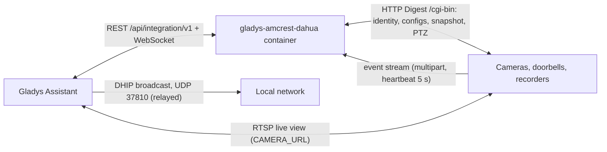
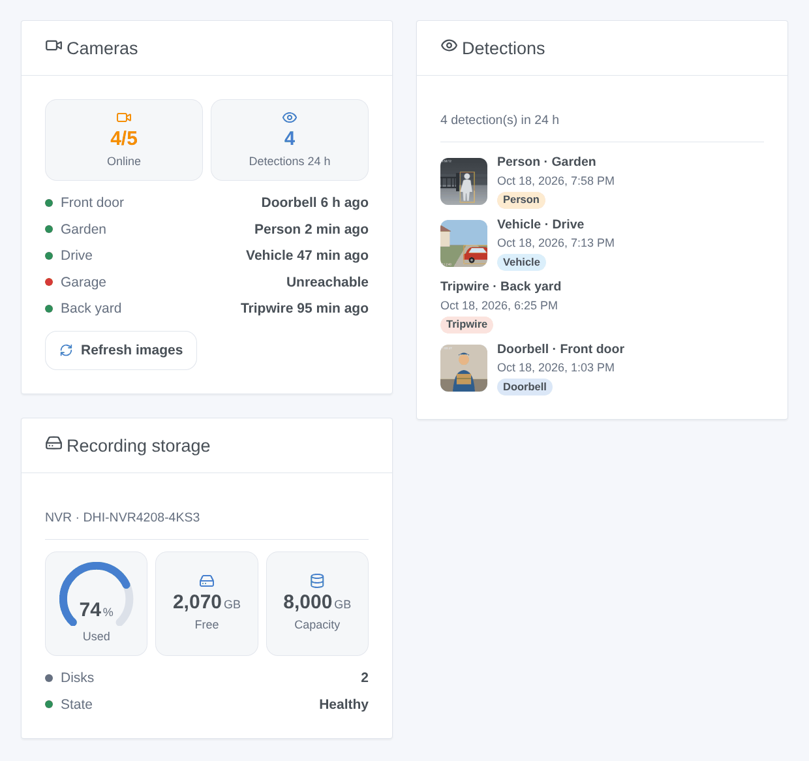

# Gladys Amcrest / Dahua

**English** · [Français](README.fr.md) · [Deutsch](README.de.md) · [Español](README.es.md)

[](LICENSE)
[](https://github.com/William-De71/gladys-amcrest-dahua/releases)
[](https://github.com/William-De71/gladys-amcrest-dahua/actions/workflows/release.yml)
[](https://gladysassistant.com)


[Gladys Assistant](https://gladysassistant.com) external integration for the cameras, doorbells and recorders built on **Dahua firmware** (Dahua, Amcrest, Lorex, Imou, EmpireTech and rebranded models). Images, live view, instant motion, person and vehicle detections, IVS rules, doorbell, privacy mode and PTZ, all over the local network, with scenes and dashboard widgets.

User documentation: [English](docs/en.md) · [Français](docs/fr.md) · [Deutsch](docs/de.md) · [Español](docs/es.md).

> Community integration, not affiliated with nor endorsed by Dahua Technology or Amcrest.

## Features

- **Discovery without typing an address**: the DHIP search of Dahua's ConfigTool, broadcast by Gladys; addresses can still be entered for another VLAN.
- **One device per camera** (one per channel of an NVR, DVR or XVR): image, RTSP live view (main or sub stream), motion, person and vehicle (smart motion detection), tripwire and intrusion (IVS), doorbell, motion detection switch, privacy mode, PTZ moves and presets — each only when the device has it.
- **Instant events**: one long-lived event stream per device (`eventManager attach`, heartbeat every 5 s), reconnected with a backoff.
- **4 scene triggers**: detection (8 kinds), alarm (video loss, alarm input, storage), camera unreachable, camera back.
- **4 scene actions**: take an image, recording mode, open the door (VTO), reboot.
- **3 dashboard widgets**: Cameras, Detections (with the image of each), Recording storage.
- **Careful with the cameras**: HTTP Digest, two requests at a time per device, images shrunk under the 150 KB of Gladys with ffmpeg, and a refused password paused for ten minutes (a camera locks the account for 30 minutes after five failures).
- Four languages everywhere: English, French, German, Spanish.

## How it works




```mermaid
sequenceDiagram
  participant U as User
  participant G as Gladys
  participant I as Integration
  participant D as Camera
  U->>G: Discover → Scan
  G->>I: scan request
  I->>G: scanNetwork(udp-active-broadcast, DHIP probe)
  G-->>I: DHIP replies (serial, model, HTTP port)
  I->>D: getSystemInfo, getConfig (MotionDetect, SmartMotionDetect, VideoAnalyseRule…), PTZ caps
  I->>G: discovered devices
  U->>G: add the camera
  G->>I: device created
  I->>D: eventManager attach (kept open)
  I->>G: states + first image
  D-->>I: Code=SmartMotionHuman;action=Start
  I->>G: Person = 1 + "detection" scene event + image
  G->>I: set value "Move: pan left"
  I->>D: ptz start Left, 600 ms, ptz stop Left
```

### Transport

`transports: ["local"]`: everything stays on your network, no account and no cloud of the brand. The only permission is the relayed UDP broadcast on port 37810 (DHIP discovery).

## Devices and features

| Feature          | When                                     | Category / type             |
| ---------------- | ---------------------------------------- | --------------------------- |
| Image            | always                                   | `camera` / `image`          |
| Motion           | always                                   | `motion-sensor` / `binary`  |
| Person, Vehicle  | smart motion detection (SMD)             | `motion-sensor` / `binary`  |
| Tripwire         | an IVS "tripwire" rule                   | `motion-sensor` / `binary`  |
| Intrusion        | an IVS "intrusion" rule                  | `motion-sensor` / `binary`  |
| Doorbell         | VTO, Amcrest AD110 / AD410, Imou DB61i…  | `doorbell` / `ring` (pulse) |
| Motion detection | `MotionDetect` readable                  | `switch` / `binary`         |
| Camera enabled   | `LeLensMask` (Amcrest, Imou privacy)     | `camera` / `enabled`        |
| Move             | PTZ (pan, tilt, zoom as the head allows) | `camera` / `move`           |
| Preset           | PTZ with saved positions                 | `camera` / `preset`         |

Devices are polled every minute (`should_poll`, 60 s) to read the switches back; the image is published on a timer (60 s by default) and on each detection. The live view of the camera box uses the `CAMERA_URL` param (RTSP).

## Scene triggers, actions and widgets



- Triggers: **detection** (camera and kind filters; variables camera name, kind, IVS rule name, object type), **alarm** (video lost, alarm input, storage failure, almost full, missing), **camera unreachable**, **camera back**.
- Actions: **take an image** (outputs: time, size), **recording mode** (schedule, always, off), **open the door** (VTO), **reboot**.
- Widgets: **Cameras**, **Detections**, **Recording storage**.
- Examples: when the doorbell is pressed, send the image of the front door; a person in the garden at night, nobody home → lights on and notification; everybody left → record always.

Not implemented: siren and white light of the active-deterrence cameras (several incompatible APIs, untestable without the hardware), infrared mode, two-way audio, recordings playback, ANPR and face recognition events, the DHIP event channel of VTO doorbells (port 5000).

## Requirements

- Gladys **5.3.0** or later (older versions cannot install the integration: catalog keywords and countries, widgets and scenes).
- A device on Dahua firmware with HTTP enabled, RTSP enabled for the live view, and its account.

## Installation

- **From the store**: Integrations → Amcrest / Dahua → Install.
- **From the repository URL**: Integrations → Add an external integration → `https://github.com/William-De71/gladys-amcrest-dahua`.
- **Developer mode**: `npm install`, then run it next to a Gladys in developer mode with the variables below.

## Configuration

| Field                   | Default | Purpose                                                      |
| ----------------------- | ------- | ------------------------------------------------------------ |
| Username                | `admin` | Account of the web interface                                 |
| Password                | —       | Its password (`secret`)                                      |
| Image refresh (seconds) | 60      | Dashboard image every N seconds, 10 to 3600, 0 = off         |
| Image on each detection | yes     | An image when a motion, a person, a vehicle or a ring starts |
| Live view stream        | main    | `main` or `sub`                                              |
| Device addresses        | —       | `192.168.1.108, 192.168.1.20:8080, https://192.168.1.30`     |
| Accounts per device     | —       | `address\|username\|password`, comma separated (`secret`)    |

Configuration actions: **Test the connection** (model, cameras and abilities of each device, or why it cannot be reached), **Refresh the images**.

## Usage

Save the account, open **Discover**, run a scan and add the cameras. Add a Camera box and the widgets to a dashboard, then build scenes on the triggers.

## Development

```bash
npm install
npm test                     # node --test, never touches the network (fake camera in memory)
npm run lint && npm run format:check
npx github:GladysAssistant/integration-store . --skip-image-check
node scripts/lab-camera.mjs  # the fake camera over real HTTP (Digest, events), for a manual check
docs/illustrations/render.sh # widget illustrations
scripts/build-cover.sh       # cover.jpg
```

Environment variables (set by the Gladys supervisor): `GLADYS_HOST_API_URL`, `GLADYS_INTEGRATION_TOKEN`, `GLADYS_INTEGRATION_SELECTOR`. The integration writes nothing to `/data`. The camera calls go through `src/dahua/transport.js` only, replaced in the tests by `test/helpers/fake-camera.js`.

## Release process


Every merge on `main` runs the CI, then computes the version from the [Conventional Commits](https://www.conventionalcommits.org/) since the last tag: `feat` → minor, `fix` / `perf` → patch, `!` or `BREAKING CHANGE` → major (a minor below 1.0.0); `docs`, `chore`, `ci`, `test`, `style`, `refactor`, `build` alone publish nothing. With no tag yet, 0.1.0 is released as is. The changelog section is generated, the tag pushed, the multi-architecture image built, then `main` receives the release commit (so the store never sees a version without its image), the GitHub Release is created and a last job checks the public image, the store validator and the topic.

- The pull request title becomes the squash commit, then the changelog line: write it in English, for the user (`pr-title.yml` checks it). Never edit `CHANGELOG.md` by hand.
- 1.0.0 is a decision: Actions → Release → Run workflow with `release-as: 1.0.0`. `dry-run` shows the version and the notes without publishing.
- **Protected branch**: the release pushes its commit to `main` with `GITHUB_TOKEN`. With a ruleset requiring pull requests or status checks on `main`, add GitHub Actions to its bypass list (or push through a GitHub App), otherwise the publish job fails. The `protect-main` ruleset (no deletion, no force push) lets it through.
- After the first release, the `ghcr.io` package must be public (Package settings → Change visibility).

## Troubleshooting

See [docs/en.md](docs/en.md#troubleshooting) (password refused and lockout, device not found by the scan, HTTP port, RTSP, missing person sensor, VTO rings). Report issues with the versions of Gladys and of the integration, the model and firmware of the device, and the result of **Test the connection**.

## Contributing

Issues and pull requests are welcome, especially reports from owners of models not tested yet. Run `npm run format:check && npm run lint && npm test` before opening a pull request, and keep every external id and stored key unchanged (see [CLAUDE.md](CLAUDE.md)).

## Security

See [SECURITY.md](SECURITY.md): report vulnerabilities privately. The passwords are `secret` fields and are never logged. The RTSP address given to Gladys for the live view (`CAMERA_URL` device param) contains the camera account, as the Gladys camera service requires: give the integration a dedicated user with the rights it needs rather than `admin` if other people administer your Gladys. HTTPS cameras use self-signed certificates, which are accepted without verification on the local network.

## License

[Apache License 2.0](LICENSE) — see also [NOTICE](NOTICE).
